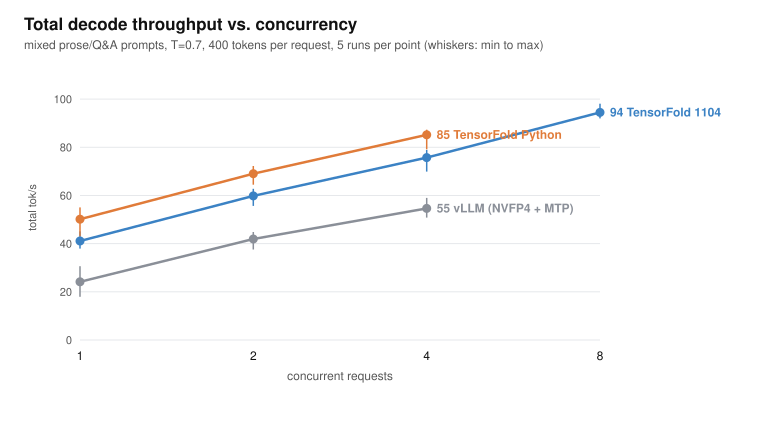
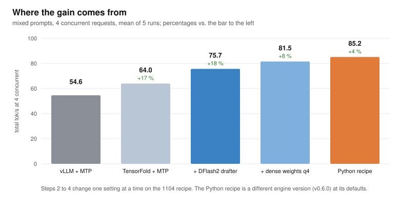
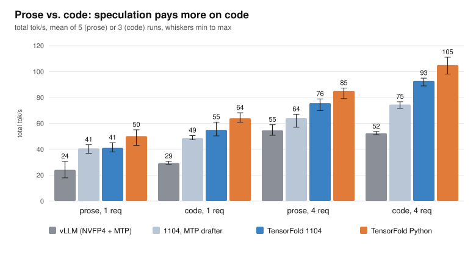
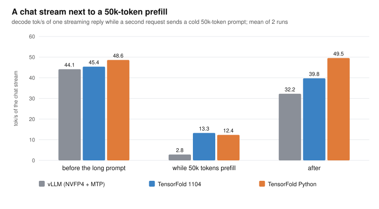
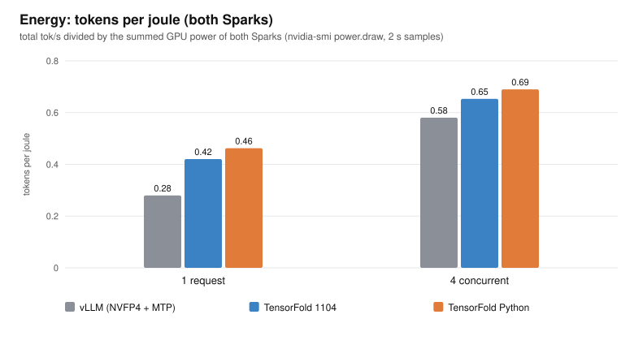
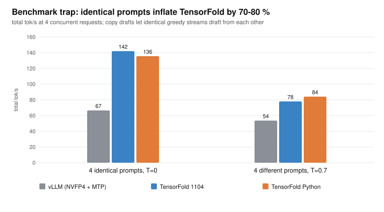

# GLM-5.3-Flash on two DGX Sparks: vLLM vs. TensorFold, measured on the same pair

**Tobias Ris, 16 November 2026**

> Also on Hugging Face: [Tobiasris/glm-5.3-flash-dgx-spark-benchmark](https://huggingface.co/datasets/Tobiasris/glm-5.3-flash-dgx-spark-benchmark) (same report and raw data).

I'm a pentester and malware analyst from Basel, and over the last months I got properly hooked on running AI locally. My home lab has two NVIDIA DGX Sparks running GLM-5.3-Flash as the local model behind my agents. For weeks it ran on vLLM (NVFP4, tensor-parallel over the ConnectX-7 cable). After reading the TensorFold recipes from Mia's AI Lab I wanted to know whether a switch would pay off. I took the pair out of production twice on the same afternoon and measured five configurations on the same hardware with the same scripts. Then I put the old server back.

**Short version, with the TensorFold Python recipe against my vLLM setup:**

| | vLLM | TensorFold Python | Difference |
| --- | ---: | ---: | ---: |
| Prose, 1 request | 24.2 tok/s | 50.2 tok/s | **+108 %** |
| Prose, 4 concurrent | 54.6 tok/s | 85.2 tok/s | **+56 %** |
| Code, 1 request | 29.4 tok/s | 64.0 tok/s | **+118 %** |
| Code, 4 concurrent | 52.4 tok/s | 105.1 tok/s | **+100 %** |
| Chat stream while a 50k prompt is read | 2.8 tok/s | 12.4 tok/s | 4.4x |
| Second turn on a 150k-token conversation | 3.3 s | 0.41 s | 8x faster |
| Tokens per joule, 4 concurrent | 0.58 | 0.69 | +19 % |
| Cold prompt reading (prefill) | 2,070 tok/s | 1,940 tok/s | −6 % |
| Correctness checks (28 tasks) | 28 / 28 | 28 / 28 | same |

Throughput numbers are means of 5 runs (prose) or 3 runs (code). vLLM wins one row, cold prefill, and TensorFold wins the rest.



## Contents

1. [Hardware and software](#1-hardware-and-software)
2. [The five configurations](#2-the-five-configurations)
3. [Method](#3-method)
4. [Throughput](#4-throughput)
5. [Where the gain comes from](#5-where-the-gain-comes-from)
6. [Prose vs. code](#6-prose-vs-code)
7. [Working next to a long prompt](#7-working-next-to-a-long-prompt)
8. [Long context and the prompt cache](#8-long-context-and-the-prompt-cache)
9. [Energy](#9-energy)
10. [Correctness](#10-correctness)
11. [A benchmark trap: identical prompts](#11-a-benchmark-trap-identical-prompts)
12. [Limits of this test](#12-limits-of-this-test)
13. [Conclusion](#13-conclusion)
14. [Reproduce it](#14-reproduce-it)
15. [Questions, feedback, help](#15-questions-feedback-help)

## 1. Hardware and software

| | |
| --- | --- |
| Machines | 2x NVIDIA DGX Spark Founders Edition (GB10, 128 GB unified memory, 4 TB NVMe) |
| Link | one QSFP cable between the ConnectX-7 ports, 200 Gb/s negotiated, RoCE v2, MTU 9000 |
| OS | DGX OS 7.5.0 (Ubuntu 24.04.5), kernel 7.0.0-1025-nvidia |
| Driver | NVIDIA 580.178.04, CUDA driver API 13.3 |
| Client | benchmark scripts on the head Spark against `127.0.0.1`, so no network between client and server |

Nothing else ran on the GPUs. My agent gateway was paused for both windows. In vLLM's request counter I see 3 requests beyond the 56 the benchmark sent during its 11-minute phase. That is light, but it may explain the wide spread in vLLM's single-request numbers (min 17.9, max 30.7).

## 2. The five configurations

| | vLLM | TF 1104 | TF 1104, dense q4 | TF 1104, MTP | TF Python |
| --- | --- | --- | --- | --- | --- |
| Engine | vLLM `0.1.dev21830+g8244d1c44` (image `eugr/spark-vllm-b12x:nightly-20261102`) | TensorFold 1.1.9 (Zig/CUDA) + 121 patches, [recipe](https://github.com/MiaAI-Lab/GLM-5.3-Flash-DGX-Sparks-1104) `80be4d6` | same | same | TensorFold v0.6.0 (Python), [recipe](https://github.com/MiaAI-Lab/GLM-5.3-Flash-EXL3-2x-DGX-Sparks-TensorFold) `3906ac6` |
| Routed experts | NVFP4 (ModelOpt mixed) | [EXL3 4 bpw](https://huggingface.co/Mia-AiLab/GLM-5.3-Flash-EXL3-4bpw-TensorFold) | EXL3 4 bpw | EXL3 4 bpw | EXL3 4 bpw |
| Dense layers | NVFP4 / MXFP8 | 8 bit | **4 bit** | 8 bit | 4 bit |
| Drafter | built-in MTP head, 5 tokens | [DFlash2](https://huggingface.co/incoai/GLM-5.3-Flash-DFlash2), 4 bit | DFlash2 | **built-in MTP head** | DFlash2 |
| KV cache | fp8 | fp8 | fp8 | fp8 | fp8 |
| Context window | 262,144 | 1,048,576 | 1,048,576 | 1,048,576 | 1,048,576 |
| Max concurrent | 4 | 8 | 8 | 8 | 4 |
| Load time | about 5 min | 147 s | 106 s | 108 s | 111 s |

The TensorFold configurations differ from their recipe defaults only in bind address, port and served model name. I also set `THINKING=1` on all of them and `PARALLEL=8` on 1104, which is the setting its README measures. On the 1104 variants exactly one setting changes at a time, which isolates the effect of that setting.

The vLLM flags that matter: `--tensor-parallel-size 2 --kv-cache-dtype fp8 --quantization modelopt_mixed --max-model-len 262144 --max-num-seqs 4 --max-num-batched-tokens 4096 --enable-prefix-caching --enable-chunked-prefill --gpu-memory-utilization 0.8 --speculative-config '{"method":"mtp","num_speculative_tokens":5}'`.

The two recipes pin different revisions of the EXL3 checkpoint (`76c0b517` and `078455ff`). The Hugging Face tree listings show identical hashes for every weight shard; only `LICENSE` and `README.md` differ. I hard-linked one download into both layouts and saved 164 GB.

## 3. Method

All scripts are standard-library Python and are in [`scripts/`](scripts/). Each ran unchanged against each server through the OpenAI-compatible API.

| Test | Script | What it does |
| --- | --- | --- |
| Throughput, prose | `bench2.py` | 16 prose and Q&A prompts in German and English. Each stream in each run gets a different prompt. Streaming, temperature 0.7, 400 output tokens, 1/2/4(/8) concurrent, **5 runs** per level |
| Throughput, code | `bench2.py` | 16 code-generation prompts (Python, C++, Rust, Go, SQL …), same procedure, 1 and 4 concurrent, 3 runs |
| Decode beside prefill | `bench2.py` | stream A writes a long essay; 4 s in, request B sends a cold 50k-token prompt. I record A's token rate before, during and after B, and A's longest gap between tokens. 2 runs |
| Long context | `bench2.py` | cold 150k-token prompt with a word to remember at the end, then a second turn on the same conversation asking for the word |
| Energy | `nvidia-smi` | `power.draw` on both Sparks every 2 s for the whole window, matched to each throughput level by time stamps |
| Correctness | `guetetest.py` | 12 exact JSON copies, 8 tool calls, 8 arithmetic problems, cold prefill at 20k and 82k tokens |
| Smoke checks | `fenster_abnahme.py pruefen` | health, model list, tool call, strict JSON schema, German umlauts |

"Total tok/s" is the sum of completion tokens divided by the wall time from the first request sent to the last byte received. "Per request" is each stream's tokens divided by its own time from first to last token. Cold prompts consist of random lowercase words that are newly generated for every request, so no prompt cache can help. TensorFold confirms this with `cached_tokens: 0`.

**Round 1** (14:18–15:06) was a single pass of each configuration. **Round 2** (15:26–16:20) is the repeated measurement and adds code, decode beside prefill, long context, energy and the two 1104 variants. All throughput figures in this report come from round 2 unless marked otherwise. Round 1 used 600 instead of 400 tokens per request. Its values lie within the round 2 min-max range for vLLM at every level and for TensorFold at two and four streams. At one stream, round 1 was 2 to 7 % above the round 2 maximum for TensorFold.

## 4. Throughput

| Concurrent | Metric | vLLM | TF 1104 | TF 1104 q4 | TF 1104 MTP | TF Python |
| --- | --- | ---: | ---: | ---: | ---: | ---: |
| 1 | total tok/s | 24.2 ±6.1 | 41.1 ±3.1 | 47.4 ±6.1 | 40.7 ±2.4 | **50.2 ±4.5** |
| | time to first token | 0.51 s | 0.16 s | 0.15 s | 0.16 s | 0.15 s |
| 2 | total tok/s | 41.9 ±2.8 | 59.8 ±2.9 | 65.6 ±3.9 | 52.6 ±1.3 | **69.1 ±3.2** |
| 4 | total tok/s | 54.6 ±3.1 | 75.7 ±3.7 | 81.5 ±3.3 | 64.0 ±4.1 | **85.2 ±3.5** |
| | per request | 14.5 | 21.0 | 22.8 | 16.9 | **23.9** |
| 8 | total tok/s | – | **94.5 ±3.0** | – | – | – |
| | per request | – | 13.4 | – | – | – |

± is the standard deviation over 5 runs. Prose prompts, T=0.7, 400 tokens per request.

Total throughput rises with concurrency, but each single request gets slower. That is batching: the GPU runs one forward pass for several requests, so four requests cost far less than four times one request. On the Python recipe each of four concurrent streams still gets 23.9 tok/s, where vLLM gives 14.5.

For one to four streams the Python recipe is the fastest configuration. Only the 1104 recipe goes beyond four streams, and at eight it reaches 94.5 tok/s in total.

## 5. Where the gain comes from



This was the question I most wanted answered, and the 1104 variants answer it. All values are at four concurrent requests:

| Step | tok/s | vs. previous |
| --- | ---: | ---: |
| vLLM, MTP drafter | 54.6 | |
| TensorFold 1104, **same MTP drafter** | 64.0 | +17 % |
| … with the DFlash2 drafter | 75.7 | +18 % |
| … with dense weights at 4 instead of 8 bit | 81.5 | +8 % |
| TensorFold Python recipe (v0.6.0, its defaults) | 85.2 | +4 % |

The jump from vLLM to TensorFold has three parts of roughly the same order:

**The engine (+17 %).** The drafter is the same in both, the built-in MTP head. The weight formats differ, NVFP4 against EXL3, but both are 4 bit for the experts. TensorFold was written for this model family, with fused MoE kernels and its own rank-to-rank exchange over RDMA. vLLM carries a general scheduler and a generic tensor-parallel path. The time to first token shows the overhead: 0.15 s against 0.51 s.

**The drafter (+18 %).** All configurations use speculative decoding. A cheap model guesses the next tokens, and the large model checks a whole block in a single forward pass and keeps the correct prefix. The output is exactly what the large model alone would produce; only the speed changes. The MTP head drafts one token at a time. DFlash2 is a separate 1.2B block-diffusion model that proposes a whole block in one pass and keeps several candidates per position.

**Dense weights at 4 bit (+8 %).** Attention, shared experts and dense layers make up a large share of the bytes read per token. At 4 instead of 8 bit, fewer bytes have to come from memory, and on a bandwidth-bound chip that shows up directly. The model card of the checkpoint measures the quality cost: KL divergence to the FP8 release rises from the floor of 0.068 to 0.090 on wikitext. My 28 checks pass either way.

The remaining 4 % between 1104 with q4 and the Python recipe is within one standard deviation.

## 6. Prose vs. code



| | vLLM | TF 1104 MTP | TF 1104 | TF Python |
| --- | ---: | ---: | ---: | ---: |
| Code, 1 request | 29.4 | 48.6 | 55.0 | **64.0** |
| Code, 4 concurrent | 52.4 | 74.6 | 92.8 | **105.1** |
| Code vs. prose, 4 concurrent | −4 % | +17 % | +23 % | +23 % |

Code is more predictable than prose, so a drafter guesses right more often and each verify pass yields more tokens. On TensorFold code runs 17 to 23 % faster than prose. vLLM gains nothing from code at four streams. My guess is that it already spends most of a round outside the drafter. For coding agents, the most common use of a Spark pair, the Python recipe produces twice vLLM's throughput.

## 7. Working next to a long prompt



In agent work requests overlap: a long prompt (a repository, a log, a document) arrives while another conversation is streaming. I measured what the streaming reply keeps:

| | vLLM | TF 1104 | TF Python |
| --- | ---: | ---: | ---: |
| Chat stream before the prompt | 44.1 tok/s | 45.4 | 48.6 |
| Chat stream while 50k tokens are read | **2.8** | 13.3 | 12.4 |
| Chat stream after | 32.2 | 39.8 | 49.5 |
| Longest gap between two tokens | 1.82 s | 2.55 s | **0.20–0.61 s** |
| Time to read the 50k prompt | **25.3 s** | 41.2 s | 33.5 s |

The engines make different trade-offs. vLLM gives the prefill nearly the whole GPU: the long prompt is done in 25 s, and the chat stream crawls at 2.8 tok/s in the meantime. TensorFold reserves a share for running streams (`PREFILL_SHARE=0.68` on 1104): the chat keeps 12 to 13 tok/s, and the long prompt takes 30 to 60 % longer. On the Python recipe the chat never paused for more than 0.6 s.

For a person watching a reply, TensorFold's behaviour feels better. For a batch job that only cares about the long request, vLLM's is faster.

## 8. Long context and the prompt cache

Cold prompt of about 150,800 tokens, then a second turn on the same conversation:

| | vLLM | TF 1104 | TF Python |
| --- | ---: | ---: | ---: |
| First turn, cold | 72.9 s (2,069 tok/s) | 83.9 s (1,796 tok/s) | 77.7 s (1,941 tok/s) |
| Second turn | 3.3 s | 2.2 s | **0.41 s** |
| Tokens served from cache in turn 2 | not reported | 147,456 | 150,784 |
| Word recalled after 150k tokens | see note | yes | yes |

All three reuse the cached conversation. The Python recipe resumes 150,784 of 150,845 tokens and answers in 0.41 s. On 1104 the cache works in steps of 4,096 tokens (as its README says), so about 3,300 tokens are read again, which costs about 2 s. vLLM reuses its prefix cache too (3.3 s instead of 73 s) but does not report the cached count.

Note on vLLM's recall: the test turns off thinking with `chat_template_kwargs.enable_thinking=false`. vLLM's reply started with reasoning text instead, and that used up the 20-token limit before the word came. This is a flaw in my test, not proof that vLLM forgot the word. TensorFold honoured the flag.

## 9. Energy



| | vLLM | TF 1104 | TF Python |
| --- | ---: | ---: | ---: |
| GPU power, both Sparks, 1 request | 86 W | 98 W | 109 W |
| GPU power, both Sparks, 4 concurrent | 94 W | 116 W | 123 W |
| Tokens per joule, 1 request | 0.28 | 0.42 | **0.46** |
| Tokens per joule, 4 concurrent | 0.58 | 0.65 | **0.69** |
| kWh per million tokens, 4 concurrent | 0.48 | 0.43 | **0.40** |

TensorFold draws more power because it keeps the GPU busier. It still uses less energy per token, because it finishes much sooner. These are GPU figures from `nvidia-smi power.draw`, not wall power. The CPU, memory, NIC and fan come on top and are not included.

## 10. Correctness

| Check | vLLM | TF 1104 | TF Python |
| --- | ---: | ---: | ---: |
| Exact JSON copy (12-digit IDs, IBAN-like strings, UUIDs, 16-digit integers) | 12 / 12 | 12 / 12 | 12 / 12 |
| Tool calls (right tool, right arguments, arrays stay arrays) | 8 / 8 | 8 / 8 | 8 / 8 |
| Arithmetic, thinking on | 8 / 8 | 8 / 8 | 8 / 8 |
| Smoke checks | 5 / 5 | 5 / 5 | 5 / 5 |

The 1104 issue tracker has an open report about digits dropped in structured JSON output. I could not reproduce it in 12 attempts on either recipe. That shows the failure is not frequent on this pair, but it does not show that it cannot happen.

## 11. A benchmark trap: identical prompts



My earlier acceptance test sent the same prompt to every stream at temperature 0. It showed 142 tok/s for TensorFold 1104 at four streams, almost twice what the same server does with four different prompts (78). The cause is TensorFold's copy drafts: when one stream has already written a token sequence, the other streams can draft from it. With identical greedy requests every stream writes the same text, and nearly every draft is accepted.

The single-request numbers agree between both methods, so the harness itself is fine. Only the concurrency numbers break. **If you benchmark an engine with copy or cache-based drafting, give every stream its own prompt.** Otherwise you report a speedup that real traffic never sees. Against vLLM I would have published 2.1x at four streams. With different prompts the real figure is 1.4x for 1104 and 1.6x for the Python recipe.

## 12. Limits of this test

- **One afternoon, one pair.** 5 runs per point give a spread but not a long-term picture. Thermal behaviour over hours, memory fragmentation and crashes under days of load are not covered.
- **The vLLM image is from 2 November.** Newer vLLM builds or vLLM with DFlash2 as drafter could close part of the gap. Section 5 suggests that vLLM with DFlash2 would gain about as much as TensorFold did, and the engine share (+17 %) would remain.
- **400 tokens per request.** Long thinking traces of several thousand tokens may behave differently.
- **vLLM may not have turned off thinking** in the throughput tests either (see section 8). That does not change the token rate much, because reasoning tokens are generated the same way. It does mean vLLM wrote different text than TensorFold.
- **Correctness is a smoke test.** 28 tasks catch a broken setup, not small losses in quality. For quality, see the checkpoint's model card: KL divergence against the FP8 release, GSM8K, HumanEval+ and MBPP+.
- **Energy is GPU power only**, read in software every 2 s.
- **Licence.** The DFlash2 weights are tagged Apache-2.0 on their model card, while both recipes describe them as CC BY-NC-ND 4.0. Check this yourself before commercial use. `DRAFTER=mtp` is the fallback; section 5 shows what it costs.

## 13. Conclusion

For a pair of DGX Sparks serving GLM-5.3-Flash to one to four clients, the TensorFold Python recipe is the better setup on my hardware. It roughly doubles single-stream speed and adds 56 % (prose) to 100 % (code) at four streams. Conversations resume from cache almost instantly, a running reply stays responsive while a long prompt comes in, and it needs less energy per token. vLLM keeps an edge of 6 to 15 % at reading cold prompts.

The gain splits into three similar parts: engine, drafter and 4-bit dense weights. The drafter and the dense weights are also available to other engines. The engine share is TensorFold's own.

If you need more than four concurrent streams, the 1104 recipe is the one that scales to eight.

## 14. Reproduce it

You need the recipes' own prerequisites (key-based ssh between the Sparks, Docker with the NVIDIA runtime, `rdma-core`, the `hf` CLI) and about 220 GiB of free disk per Spark.

```bash
# throughput, code, decode beside prefill, long context
python3 scripts/bench2.py --base http://127.0.0.1:8888 --model <served-name> --name myrun --levels 1,2,4 --runs 5

# correctness and cold prefill
python3 scripts/guetetest.py --basis http://127.0.0.1:8888 --modell <served-name> --name myrun

# smoke checks
python3 scripts/fenster_abnahme.py --basis http://127.0.0.1:8888 --modell <served-name> pruefen

# power, on each Spark, while the benchmark runs
nvidia-smi --query-gpu=timestamp,power.draw --format=csv,noheader,nounits -l 2 > power.csv

# charts from results/
python3 scripts/charts.py
```

`guetetest.py` and `fenster_abnahme.py` use German option names: `--basis` is the base URL, `--modell` the model name. In their output `bestanden` means passed, `von` out of, `gesamt_tok_s` total tok/s and `je_anfrage_tok_s` tok/s per request.

Raw data in [`results/`](results/):

| File | Content |
| --- | --- |
| `r2-{vllm,tfpy,tf1104,tf1104-q4,tf1104-mtp}.json` | round 2: throughput with all runs, code, decode beside prefill, long context |
| `r2-power-head.csv`, `r2-power-worker.csv` | GPU power of both Sparks during round 2 |
| `gemischt-*.json`, `fenster-*.json` | round 1: mixed and identical-prompt throughput |
| `{vllm,tf1104,tfpy}-guete.json` | correctness and cold prefill |

Before publishing I replaced a local place name, a home directory and the names of my own services in three test prompts. Otherwise the scripts are exactly the ones that produced these numbers.

## 15. Questions, feedback, help

I'm sharing this because I spent quite a few evenings reading other people's numbers before I measured my own, and I'd like to give something back. If you run a Spark pair, or another GB10 setup, I'd love to hear what you see:

- **Questions about the setup or the scripts:** open an issue. I'm happy to help you get either recipe running or to explain a number.
- **Your own measurements:** post them in an issue or a discussion, the more configurations the better. Numbers that contradict mine are especially welcome. A newer vLLM build with DFlash2 is the comparison I'd most like to see.
- **Corrections:** if I got something wrong, tell me and I'll fix it and say so in the changelog below.

## Changelog

- 16 November 2026: first version, two measurement rounds.

## License

Scripts: MIT. Report text, charts and measurement data: CC BY 4.0. You can use, change and share everything here, including commercially, as long as you credit the source. See `LICENSE`.

## Credits

- [Z.AI](https://huggingface.co/zai-org/GLM-5.3-Flash) for GLM-5.3-Flash.
- [Mia's AI Lab](https://github.com/MiaAI-Lab) for both recipes and the EXL3 quant, and for publishing their measurements with the failures left in.
- [TensorFold](https://github.com/ashhart/TensorFold) and [vLLM](https://github.com/vllm-project/vllm).
- [Inco AI](https://huggingface.co/incoai/GLM-5.3-Flash-DFlash2) for DFlash2.
- eugr for the Spark vLLM images I have been running on.
